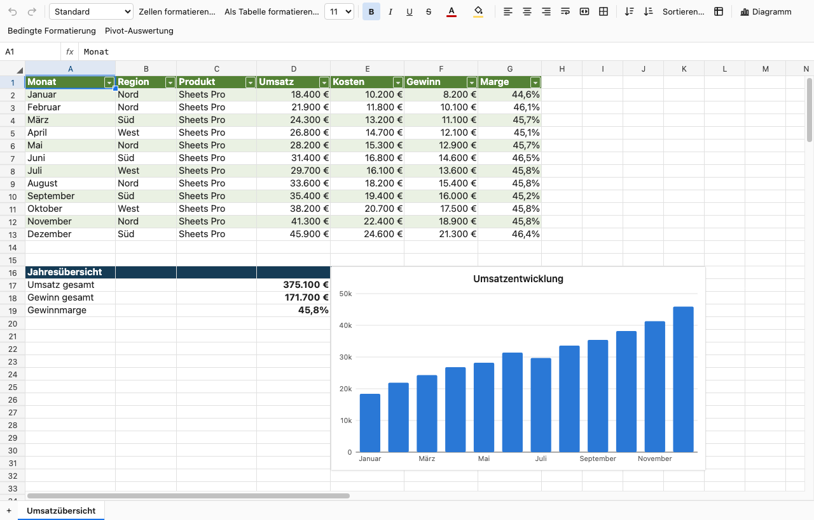

# Sheets – Excel & CSV Editor

Excel- und CSV-Dateien direkt in Visual Studio Code öffnen und bearbeiten. Sheets bringt einen Tabelleneditor mit Formeln, Formatierung, Filtern und Diagrammen mit. Microsoft Excel oder ein externer Dienst sind dafür nicht erforderlich.



## Installation

Die Extension lässt sich als VSIX aus diesem Repository bauen:

```bash
npm ci
npm run package
```

Danach in VS Code **Extensions: Install from VSIX…** ausführen und `artifacts/sheets-vscode-1.2.0.vsix` auswählen. Alternativ:

```bash
code --install-extension artifacts/sheets-vscode-1.1.0.vsix
```

Voraussetzungen: VS Code 1.95 oder neuer; zum Entwickeln und Paketieren Node.js 22 oder neuer. Das Paket enthält alle Laufzeitabhängigkeiten.

Sheets ist für VS Code Desktop unter **Windows, macOS und Linux** ausgelegt. Dieselbe VSIX enthält ausschließlich JavaScript und funktioniert ohne Excel oder native Zusatzmodule auf allen drei Systemen. Tastenkürzel verwenden `Ctrl` unter Windows/Linux und `Cmd` unter macOS; AltGr-Zeichen werden als Texteingabe behandelt. Agent-Werkzeuge akzeptieren auch Windows-Laufwerkspfade, UNC-Netzwerkpfade und relative Pfade mit Backslashes. Die CI prüft Tests, Build und VSIX-Paketierung auf allen drei Betriebssystemen. Eine reine Browser-Installation (vscode.dev) wird nicht unterstützt.

Beim Start von VS Code prüft Sheets, ob in den GitHub Releases eine neuere Version liegt, und bietet dann einen Link zum Release an. Dabei wird nur die öffentliche GitHub-API abgefragt; es werden keine Daten gesendet. Abschalten lässt sich das mit `sheets.checkForUpdates`.

## Erste Schritte

- Eine `.xlsx`- oder `.xlsm`-Datei öffnen: Sie erscheint direkt im Sheets-Editor.
- Eine `.csv`- oder `.tsv`-Datei im Explorer rechts anklicken und **Mit Sheets öffnen** wählen. Alternativ **Öffnen mit… → Sheets (CSV)** verwenden.
- Über die Befehlspalette **Sheets: Tabellendatei öffnen…** eine Datei auswählen oder mit **Sheets: Neue Arbeitsmappe** eine neue XLSX-Datei anlegen.
- Mit `Ctrl+S` / `Cmd+S` speichern. Rückgängig und Wiederholen sind mit VS Code verbunden.

Die Bezeichnungen folgen der Sprache von VS Code. Englisch und Deutsch werden unterstützt.

Falls XLSX weiterhin in einem anderen Editor öffnet: Nach der Installation **Developer: Reload Window** ausführen und die Datei schließen und erneut öffnen. Eine bereits konfigurierte Benutzer- oder Workspace-Zuordnung hat Vorrang vor dem Extension-Standard. In diesem Fall über **Öffnen mit… → Standardeditor für „*.xlsx“ konfigurieren… → Sheets** die Zuordnung ändern. In `settings.json` entspricht das:

```json
"workbench.editorAssociations": {
  "*.xlsx": "sheets.spreadsheet"
}
```

## Funktionen

- Zellen bearbeiten, kopieren, einfügen und automatisch ausfüllen; Zeilen, Spalten und Blätter verwalten, aus- und einblenden (`Ctrl+9` / `Ctrl+0`, mit Shift einblenden).
- Inhalte einfügen: nur Werte (`Ctrl+Shift+V`), Formeln oder Formate, Leerzellen überspringen und Transponieren (`Ctrl+Alt+V`).
- Suchen und Ersetzen (`Ctrl+F` / `Ctrl+H`, auf macOS `Cmd+F` / `Cmd+Option+F`) im Blatt oder in der ganzen Mappe, auch in Formeln und mit regulären Ausdrücken.
- Gehe zu Zelle, Bereich oder Name (`Ctrl+G` / `Cmd+G`) und Zoom von 25 % bis 400 % (`Ctrl`+Mausrad, Zoomregler in der Statusleiste).
- Zahlen-, Währungs-, Prozent-, Datums- und eigene Zellformate; Schrift, Farben, Rahmen und Ausrichtung. Zellformatierung über `Ctrl+1` / `Cmd+1`.
- Tabellen hervorheben, komplette Datensätze sortieren und über die Kopfzeilen nach Werten filtern. Wertefilter bieten Suche, Mehrfachauswahl und leere Werte. Strukturierte Verweise wie `Tabelle1[Umsatz]` oder `[@Menge]` funktionieren in Formeln.
- Formeln mit über 200 Funktionen, darunter `XLOOKUP`, `FILTER`, `SORTBY`, `LET`, `LAMBDA`, `MAP`, `REDUCE`, `VSTACK`, `TEXTSPLIT`, `XIRR` und `AGGREGATE`; Vorschläge und farbige Zellreferenzen während der Eingabe.
- Datenüberprüfung mit Dropdown-Listen, Zahlen-, Datums- und Textlängengrenzen sowie eigenen Formeln, Eingabe- und Fehlermeldungen.
- Bedingte Formatierung mit Zellvergleichen, Formelregeln, Farbskalen, Datenbalken und Symbolsätzen.
- Notizen werden angezeigt, Hyperlinks und `HYPERLINK`-Formeln öffnen sich mit `Ctrl`/`Cmd`+Klick.
- Säulen-, Balken-, Linien-, Flächen-, Kreis-, Ring- und Punktdiagramme erstellen und bearbeiten.
- Pivot-Auswertungen mit Gruppen, Aggregaten und Gesamtsummen erstellen und aktualisieren.
- Excel-Tabellen, Zellformate, Diagramme und Wertefilter in XLSX speichern. CSV-Trennzeichen bleiben beim Speichern erhalten. **Sheets: Blatt als CSV exportieren…** schreibt das aktive Blatt in eine CSV- oder TSV-Datei.
- Lässt sich eine Änderung nicht verlustfrei als XLSX speichern, zeigt der Editor das sofort über der Tabelle an, nicht erst beim Speichern.
- Helles und dunkles VS-Code-Theme sowie fixierte Zeilen und Spalten.

## KI-Agents

Im Copilot-Chat **Agent** wählen und unter **Configure Tools / Werkzeuge konfigurieren** die Sheets-Werkzeuge aktivieren. Für Agent Mode eine aktuelle VS-Code-Version verwenden (Extension-Werkzeuge werden dort seit VS Code 1.99 unterstützt).

Sheets registriert 45 Werkzeuge (`sheets_*`) für Clients, die die VS-Code-Language-Model-Tools unterstützen, beispielsweise Copilot im Agent-Modus. Sie können Bereiche lesen und schreiben, suchen und ersetzen, Formeln und Formate anwenden, Tabellen, Diagramme und Datenüberprüfungen anlegen, Zeilen ausblenden oder sortieren.

Änderungen an geöffneten Dateien erscheinen im Editor und lassen sich rückgängig machen. Die Einstellung `sheets.agentTools.headlessWrites` erlaubt zusätzlich Änderungen an ungeöffneten Dateien, die direkt gespeichert werden. Diese Funktion erfordert einen vertrauenswürdigen Arbeitsbereich. Für die manuelle Tabellenbearbeitung wird kein KI-Konto benötigt.

Andere Extensions können `sheets.executeTool` aufrufen:

```ts
await vscode.commands.executeCommand('sheets.executeTool', {
  name: 'read_range',
  file: '/path/to/workbook.xlsx',
  input: { range: 'A1:D10' },
});
```

Die Tabellenverarbeitung läuft lokal. Die Extension sendet selbst keine Tabellendaten an externe Dienste; ein von dir eingesetzter KI-Client kann Werkzeugergebnisse an seinen Anbieter übertragen.

## Unterstützte Formate und Grenzen

Unterstützt werden `.xlsx`, `.xlsm`, `.csv` und `.tsv`. In `.xlsm`-Dateien bleiben Makros erhalten, werden aber nie ausgeführt. Das alte `.xls`-Format wird nicht unterstützt. CSV/TSV können nur Werte eines Blatts speichern, keine Formatierung oder Diagramme.

Nicht alle Excel-Funktionen werden im Editor dargestellt oder bearbeitet. Dazu gehören native Pivot-Caches und Bilder; Notizen werden nur angezeigt, nicht bearbeitet. Eingebaute Excel-Tabellenstile werden im Editor teilweise näherungsweise blau dargestellt; der ursprüngliche Stil bleibt in der Datei erhalten.

Beim Speichern bleibt das Originalpaket die Grundlage. Nicht implementierte Bestandteile werden mitgeführt. Ohne Änderung wird die Datei bytegenau zurückgegeben. Änderungen, die sich nicht sicher übertragen lassen – etwa Struktur- oder Sortieränderungen mit unbekannten Excel-Inhalten –, werden vor dem Überschreiben mit einer Fehlermeldung blockiert. Wiederherstellungssicherungen behalten auch solche ungespeicherten Änderungen. Details: [XLSX-Kompatibilität und Speicherschutz](docs/xlsx-compatibility.md).

## Entwicklung

```bash
npm ci
npm run build        # Typprüfung und beide Extension-Bundles
npm test             # Core-, UI-, Agent- und Extension-Tests
npm run package      # Build, VSIX und Prüfung des fertigen Pakets
npm run check:package
```

Das Repository in VS Code öffnen und **F5** drücken. Die Konfiguration „Sheets: Extension starten“ baut die Extension im Watch-Modus und öffnet einen Extension Development Host. Nach Änderungen am Host-Code dessen Fenster neu laden; nach Änderungen am Webview den Tabelleneditor erneut öffnen.

Die Web-Demo bleibt über `npm run dev:web` verfügbar. `npm run build:all` baut zusätzlich Web-Demo und MCP-Server.

## Lizenz

MIT. Siehe LICENSE.
