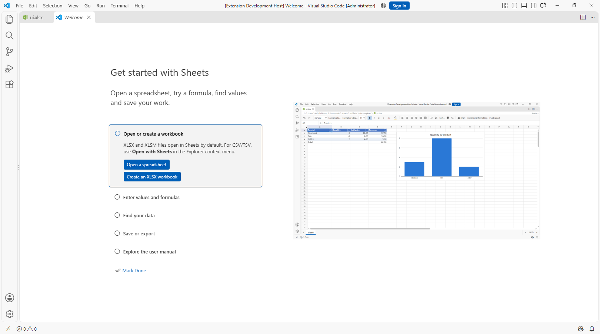
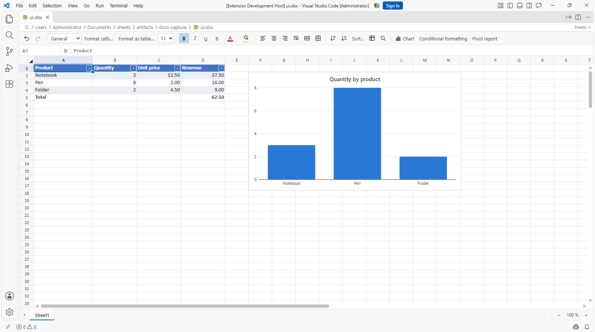
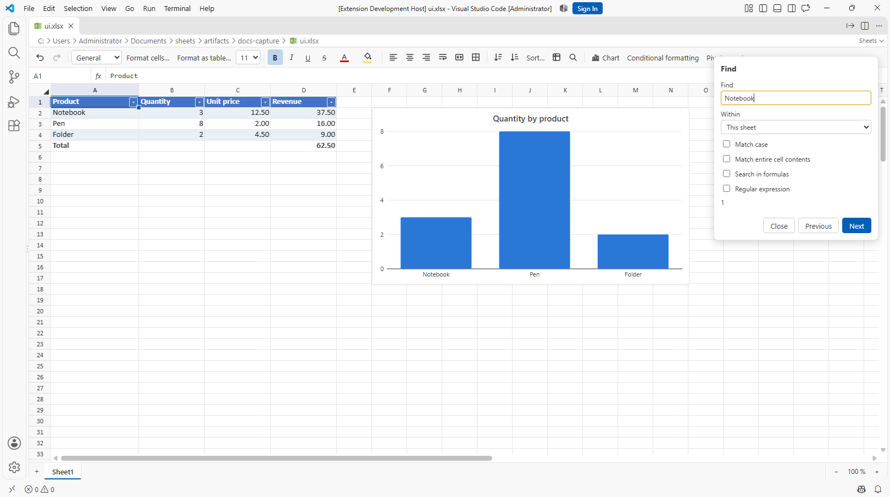

# Sheets user manual

[Deutsch](manual.de.md) · [README](../README.md)

This guide covers the Sheets extension for VS Code Desktop on Windows, macOS and Linux. Commands below use the English UI. In a German VS Code installation, Sheets translates its commands and dialogs. Open this guide at any time with **Sheets: Open User Manual**; open the guided introduction with **Sheets: Getting Started**.

## Contents

- [Install and open files](#install-and-open-files)
- [Your first workbook](#your-first-workbook)
- [Navigate and edit](#navigate-and-edit)
- [Formulas](#formulas)
- [Formatting and tables](#formatting-and-tables)
- [Find and replace](#find-and-replace)
- [Charts and analysis](#charts-and-analysis)
- [Save and export](#save-and-export)
- [AI assistance](#ai-assistance)
- [Settings and troubleshooting](#settings-and-troubleshooting)

## Install and open files



*The five-step introduction, captured with Windows MCP.*

Install the release VSIX using **Extensions: Install from VSIX…**, then reload VS Code if requested. VS Code 1.95 or later is required; Excel is not required. See the [README](../README.md#installation) for build instructions.

Open `.xlsx` and `.xlsm` files from Explorer. For `.csv` and `.tsv`, right-click and select **Open with Sheets**, or use **Reopen Editor With… → Sheets (CSV)**. **Sheets: Open Spreadsheet…** opens a file picker for any supported format. Legacy `.xls` files must first be converted in another spreadsheet application.

Run commands from the Command Palette: **Ctrl+Shift+P** on Windows/Linux or **Cmd+Shift+P** on macOS. The walkthrough is also available from VS Code's Getting Started page. Manual editing needs no AI account or trusted workspace.

## Your first workbook

1. Run **Sheets: New Workbook** and choose a filename ending in `.xlsx`. The command creates and opens the file.
2. Select A1 and paste the following tab-separated text:

   ```text
   Product	Quantity	Unit price	Revenue
   Notebook	3	12.5	=B2*C2
   Pen	8	2	=B3*C3
   Folder	2	4.5	=B4*C4
   Total			=SUM(D2:D4)
   ```

3. D2:D4 should show **37.5**, **16** and **9**; D5 should show **62.5**.
4. Select A1:D1 and apply bold using the toolbar. Select C2:D5, open **Format cells…** with **Ctrl+1** / **Cmd+1**, and choose a number or currency format with two decimal places.
5. Save with **Ctrl+S** / **Cmd+S**.

Alternatively, open [getting-started.csv](examples/getting-started.csv), which contains the three input columns. Use an XLSX workbook for the full exercise so formulas, styles and charts can be retained.



*Actual VS Code Desktop screenshot captured with Windows MCP. The screenshot data illustrates the interface; use the values above for the exercise.*

## Navigate and edit

Click a cell and type to replace its value. Double-click to edit existing content, or use the formula bar. Confirm with Enter; use Escape to cancel an edit. Drag across cells to select a range. Use the name box or **Sheets: Go To Cell…** to jump to a cell, range or defined name, for example `D5` or `A1:D5`.

Copy and paste rectangular data with the usual shortcuts. **Paste values** inserts results without formulas; **Paste special…** offers formulas, formats, skipping blanks and transposition. Drag the selection's fill handle to fill adjacent cells. Right-click row/column headers for insertion, deletion and hiding. Use sheet tabs and their context menus to switch, rename or manage sheets. Available changes can be restricted by XLSX preservation rules.

Freeze rows and columns through **Freeze panes** in the toolbar. Adjust zoom through the status bar or **Sheets: Zoom In**, **Zoom Out** and **Reset Zoom**. The supported range is 25–400%.

| Action | Windows / Linux | macOS |
| --- | --- | --- |
| Save | Ctrl+S | Cmd+S |
| Undo / redo | Ctrl+Z / Ctrl+Shift+Z | Cmd+Z / Cmd+Shift+Z |
| Copy / cut / paste | Ctrl+C / Ctrl+X / Ctrl+V | Cmd+C / Cmd+X / Cmd+V |
| Paste values | Ctrl+Shift+V | Cmd+Shift+V |
| Paste special | Ctrl+Alt+V | Cmd+Alt+V |
| Format cells | Ctrl+1 | Cmd+1 |
| Find | Ctrl+F | Cmd+F |
| Replace | Ctrl+H | Cmd+Option+F |
| Go to | Ctrl+G | Cmd+G |

Shortcuts apply while the spreadsheet has focus. The Command Palette provides the Sheets navigation, search and zoom commands if a system shortcut is intercepted.

## Formulas

Start a formula with `=`. Use **English function names, commas between arguments, and a decimal point** in formula literals, in both UI languages. For example: `=IF(B2>2,SUM(D2:D4),0)`. A semicolon is not the argument separator. The display format can still show localized numbers.

`B2` is relative; `$B$2` fixes row and column. Filling `=B2*C2` down changes the references to `=B3*C3`. Reference another sheet as `='Sales 2026'!D2`. Formula entry provides suggestions and colored references. Supported functions include lookups, dynamic arrays and `LET`/`LAMBDA`; support does not cover every Excel function.

For `#NAME?`, check function spelling and whether the function is implemented. For `#REF!`, check referenced cells and sheets. For `#DIV/0!`, inspect the denominator. Unsupported Excel formulas may retain their stored result from the source file; Sheets cannot calculate arbitrary Excel functions or run macros.

## Formatting and tables

Select the target range, then use the toolbar or **Format cells…** to change fonts, colors, alignment, borders and number formats. Formatting changes how a value appears; it does not change the underlying number.

To filter the three product records in the exercise, select **A1:D4**, excluding the total row, and choose **Format as table…**. Give the table a name and confirm that the first row contains headers. Open a header's filter menu, search for values and select the values to show. Clear the column filter to show all records again. Filtering hides records; it does not delete them.

Use the table menu or **Sort…** to sort complete records by one or more columns. Keep associated columns together when selecting a sort range. Structured references such as `Table1[Revenue]` and `[@Quantity]` can be used in formulas with the actual table and header names.

## Find and replace

Open **Sheets: Find** or **Sheets: Find and Replace**. Enter a search term and choose whether to search the current sheet or the entire workbook, values or formulas. Enable case sensitivity, whole-cell matching or regular expressions as needed. Move through matches before replacing, or replace all matches in the selected scope. Press Escape to close the panel.



*Search panel captured in VS Code Desktop with Windows MCP.*

## Charts and analysis

Select a range containing labels and numeric data, then use **Insert chart** in the toolbar. Choose a chart type and configure its source range and title in the chart controls. For the example, A1:B4 gives quantities by product. Charts can be moved and resized. Save the workbook as XLSX to retain them.

Use **Conditional formatting** to apply a comparison or formula rule, color scale, data bar or icon set to a selected range. A formula rule should be written relative to the range's top-left cell.

Use **Data validation** for dropdown lists or restrictions on numbers, dates, text length or custom formulas. Configure the target range and rule, then add input/error messages as needed.

To summarize a dataset, open **Pivot report**, choose the source range, row/column groups, value field, aggregation and target cell. Use **Refresh pivot reports** after changing the source. Sheets reports are distinct from Excel's native pivot caches; editing native pivot output can be blocked to preserve the original file.

Notes from imported workbooks are displayed but cannot be edited. Open hyperlinks and `HYPERLINK` results with Ctrl/Cmd+click.

## Save and export

**Ctrl+S** / **Cmd+S** saves the open document; undo/redo integrates with VS Code. **Save As** uses the target file's format. To create a values-only copy, run **Sheets: Export Sheet as CSV…**, choose comma, semicolon or tab, then choose the destination. Export writes the active sheet without replacing the source workbook.

| Format | What to expect |
| --- | --- |
| XLSX | Multiple sheets, formulas, supported formatting, tables and charts. Unsupported original parts are preserved where safe. |
| XLSM | Macro content is preserved; macros never run in Sheets. |
| CSV / TSV | Values from one data sheet only. No workbook formatting, charts or additional sheets. |

CSV saves retain the detected delimiter, line endings, UTF-8 BOM and supported source encoding (UTF-8 or Windows-1252). Unchanged records are retained verbatim where possible. Identifiers with leading zeros remain text. If new characters cannot be represented in Windows-1252, Sheets switches to UTF-8 with BOM and shows a notice.

If an **XLSX protection** message appears above the grid, an edit cannot be written safely while preserving unmodeled Excel content. Undo the indicated change or export the needed values to a separate CSV file. Save As does not bypass the protection. Unchanged unsupported contents stay in the original package. Recovery backups retain pending edits, but do not remove save restrictions. See [XLSX compatibility (German)](xlsx-compatibility.md) for details.

If the source changed externally, Sheets refuses to overwrite it. Preserve your pending values separately, then reopen the current file and reconcile the changes.

## AI assistance

Use a current VS Code version with a compatible AI client, such as Copilot Agent mode (extension tools require VS Code 1.99 or later). Enable the `sheets_*` tools in the client's tool selector. Try: “Read A1:D5 in the open workbook and explain how the total is calculated.” Or: “Format C2:D5 with two decimal places.” Review the resulting changes and save the open workbook yourself.

Changes to open documents appear live and can be undone. With `sheets.agentTools.headlessWrites` enabled, agents may modify unopened files and save them directly; this requires a trusted workspace. Turn the setting off to require opening files before agent edits. Sheets runs spreadsheet operations locally; the AI client may transmit tool input and output to its service. More examples: [Copilot guide (German)](copilot.md).

## Settings and troubleshooting

| Setting | Default | Effect |
| --- | --- | --- |
| `sheets.checkForUpdates` | `true` | Checks public GitHub Releases at startup and offers an update. |
| `sheets.agentTools.headlessWrites` | `true` | Allows agents to save unopened files in trusted workspaces. |

**A workbook opens as binary text or in another extension:** reload the window, then close and reopen the tab. Use **Reopen Editor With… → Sheets** and configure Sheets as the default editor for `*.xlsx` if desired. Existing user/workspace editor associations take precedence.

**CSV opens as text:** this is expected until you choose **Open with Sheets** or **Sheets (CSV)** from the editor selector.

**A formula or chart is missing after CSV save:** CSV retains values only. Use XLSX for workbooks with these features.

**A Sheets command does nothing:** focus an open Sheets spreadsheet first. Search, zoom and export operate on the active Sheets document.

**The walkthrough or manual is missing:** install the updated VSIX, reload VS Code, then run **Sheets: Getting Started** or **Sheets: Open User Manual**.
